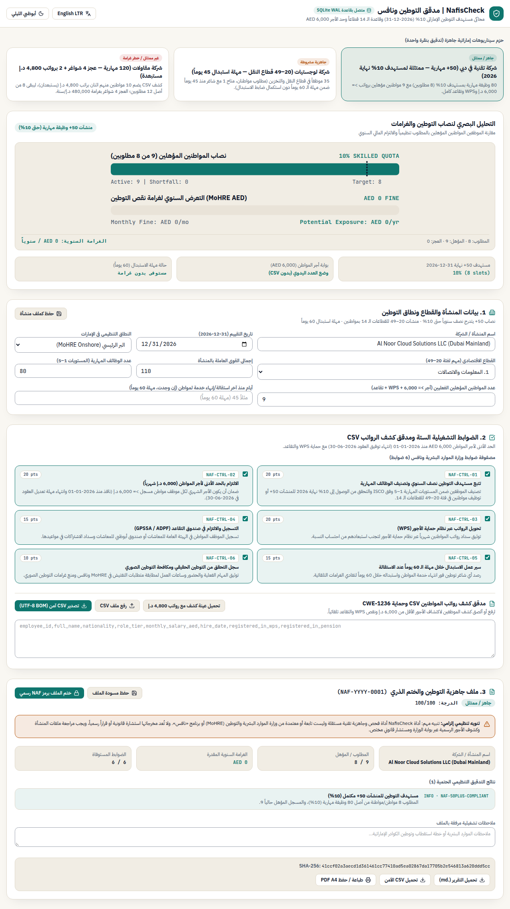
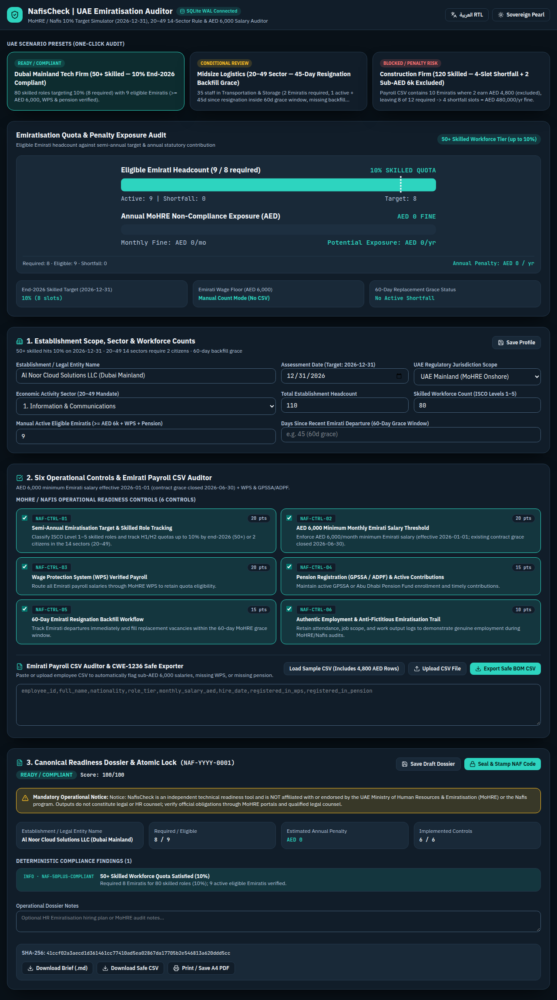
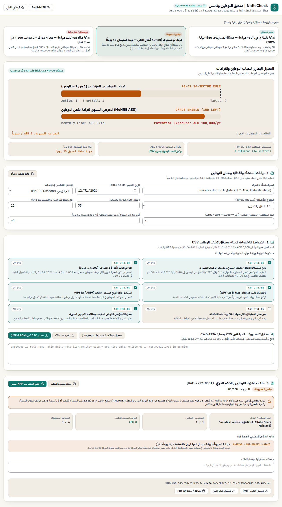
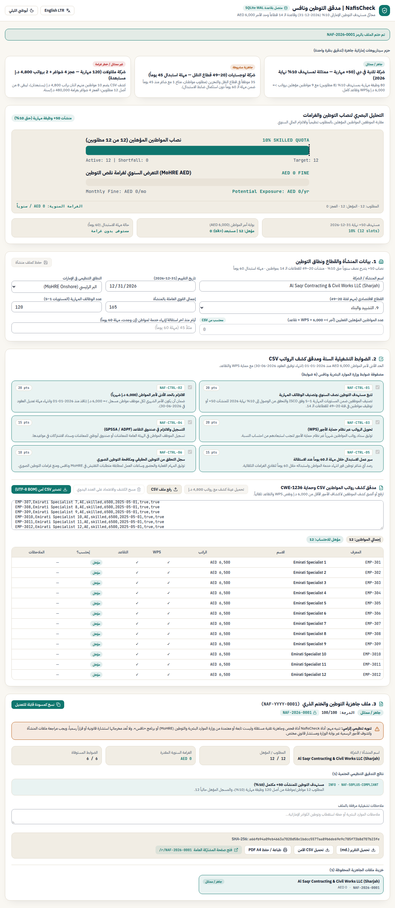
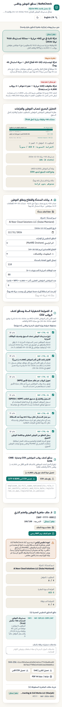
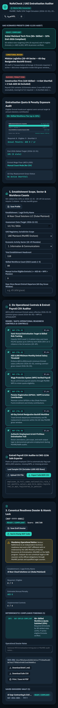

# NafisCheck — UAE MoHRE & Nafis Emiratisation Calculator & Payroll CSV Auditor

[](LICENSE)

> **Arabic-First (`RTL` `Sovereign Pearl` Light) & English (`LTR` `Abu Dhabi Night` Dark) · Dual-Mode (`SQLite WAL` or `$0` Browser Static Mode)**

An open-source Emiratisation readiness engine and payroll CSV auditor built for UAE private-sector establishments — tracking **MoHRE's 50+ skilled workforce semi-annual trajectory up to `10%` on `31 December 2026`**, enforcing the **`20–49` 14-sector rule**, validating the **`AED 6,000/month` minimum Emirati salary floor** (`2026-01-01`), **`WPS` + `GPSSA/ADPF`** registration, **`60`-day backfill grace**, and **`CWE-1236`-safe UTF-8 BOM CSV exports**.

> **Mandatory Disclaimer:** NafisCheck is an independent technical readiness tool and is **NOT** affiliated with or endorsed by the UAE Ministry of Human Resources & Emiratisation (`MoHRE`) or the `Nafis` program. Outputs do **not** constitute legal or HR counsel; verify official quotas, exemptions, and penalties directly via MoHRE / Nafis portals and qualified counsel.

---

## Core UAE MoHRE / Nafis Capabilities
- **50+ Skilled Workforce Semi-Annual Engine (`10%` End-2026 Target)**:
  - Models semi-annual `+1%` increments (`9%` on `2026-06-30` -> **`10%` on `2026-12-31`**) over ISCO Levels 1–5 skilled roles (`Math.ceil`).
  - Quantifies statutory non-compliance contributions (`AED 8,000/mo` in 2024, `AED 9,000/mo` in 2025, **`AED 10,000/mo` = `AED 120,000/yr` per unfilled slot in `2026+`**).
- **`20–49` Employee 14-Sector Rule & 60-Day Replacement Grace**:
  - Covers all **14 designated MoHRE economic sectors** (`1` -> **`2` Emiratis in 2025–2026+**, **`AED 108,000/yr`** statutory fine if left unfilled past **`60` days** after an Emirati resignation).
  - Properly exempts UAE Free Zone entities (`DIFC`, `ADGM`, etc.) and sub-threshold establishments.
- **`AED 6,000` Emirati Payroll CSV Auditor & CWE-1236 Safe Exporter**:
  - Parses employee rosters, enforces `monthly_salary_aed >= 6,000` (contract adjustment grace window ended `2026-06-30`), verifies **WPS** routing and **GPSSA / ADPF** pension enrollment, and flags sub-minimum or unregistered rows automatically.
  - Escapes formula-injection prefixes (`=`, `+`, `-`, `@`, `\t`, `\r`) against `CWE-1236` and exports **`UTF-8 BOM`** (`EF BB BF`) CSVs.
- **Immutable `NAF-YYYY-0001` Dossiers & Bilingual Studio (`AR RTL` / `EN LTR`)**:
  - Dual-mode persistence (`Node 22 + node:sqlite WAL` or `$0` browser `localStorage`), Web Crypto `SHA-256` canonical digests, public read-only `/r/:slugOrCode` view, and **`A4 PDF`** print sheets.

---

## Visual Showcase (`AR RTL` & `EN LTR`)

### Desktop Arabic RTL (`Sovereign Pearl` Light — 10% Skilled Quota Compliant)


### Desktop English LTR (`Abu Dhabi Night` Dark)


### 20–49 Designated 14-Sector Rule (`60-Day Replacement Grace Window`)


### Remediated Payroll CSV & Sealed `NAF-2026-0001` Dossier


### Mobile Arabic RTL View (`390x844`)


### Mobile English LTR View (`Abu Dhabi Night`, `390x844`)


---

## Quick Start (`$0` Self-Hosted or Static)

```bash
npm ci
npm run typecheck
npm test        # Core & Node 22 SQLite WAL server tests (13 tests)
npm run build   # Builds static bundle into ./dist
npm start       # Serves API + React UI on http://127.0.0.1:4219
```

### Zero-Server Static Deploy (`$0` Cloudflare Workers Static Assets)
```bash
npm run build
npx wrangler deploy
```

### Playwright Chrome E2E Verification
```bash
npm run test:e2e
```

---

## License

Released under the [MIT License](LICENSE).
